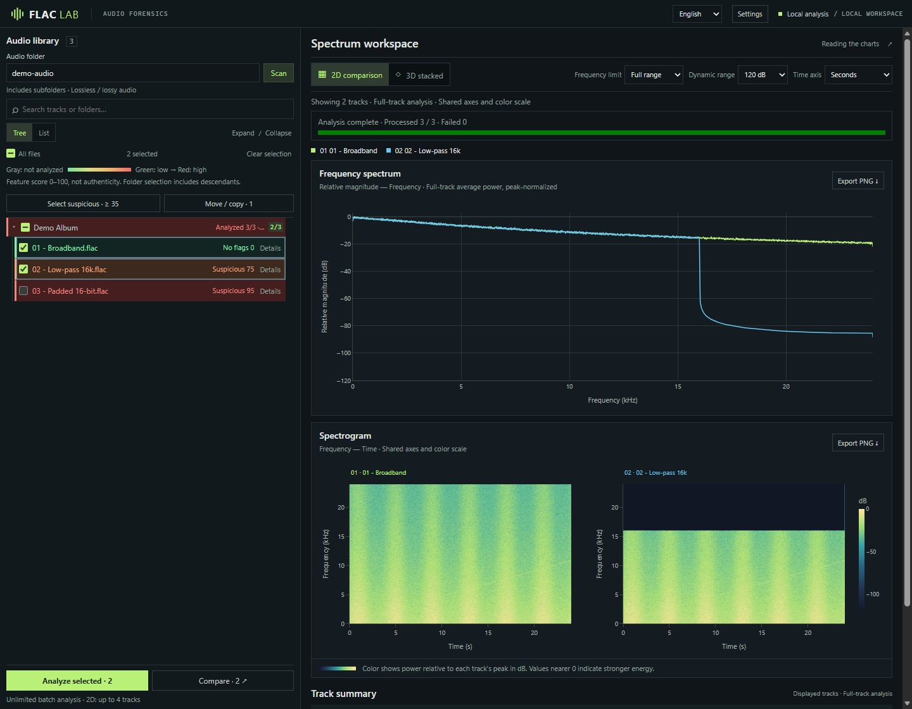
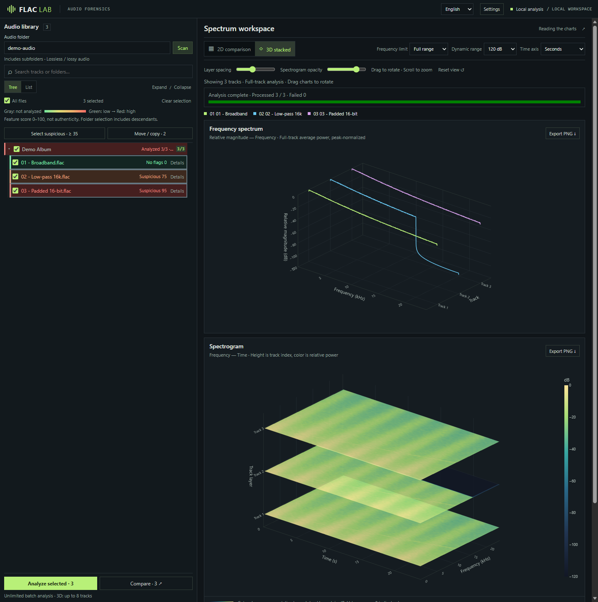

# LosslessLens

[English](README.md) | [简体中文](README.zh-CN.md) | [繁體中文](README.zh-TW.md) | **日本語**

ローカルで動作する音声のスクリーニング・スペクトル比較ツールです。非可逆圧縮音源からの変換、アップサンプリング、ビット深度の水増しの兆候をまとめて調べ、2D / 3D グラフで詳しく比較できます。

**[クイックスタート](#クイックスタート)** · [使い方ガイド（簡体字中国語）](docs/usage.md) · [CLI](#その他の使い方)

> スコアは疑わしい特徴の強さを示すもので、真偽の確率ではありません。録音帯域やマスタリング時のフィルターでも同様の兆候が現れます。異常が検出されなくても、ロスレス音源であることの証明にはなりません。

## 主な機能

- **一括スクリーニング**：サブフォルダーを含めて検索し、ファイルやフォルダー単位で選択。複数プロセスで解析し、曲ごとのスコアと根拠を表示します。
- **スペクトル比較**：2D は最大 4 曲、3D は最大 8 曲に対応。周波数・時間軸と色スケールを揃え、PNG に書き出せます。
- **曲の整理**：設定したスコアのしきい値で一括選択し、指定フォルダーへコピー・移動。フォルダー構造は既定で保持し、同名ファイルは上書きしません。
- **複数形式に対応**：FLAC、WAV、AIFF、MP3、M4A、AAC、OGG、Opus など。一部の形式には FFmpeg が必要です。
- **ローカル処理**：サーバーは `127.0.0.1` のみで待ち受け、グラフのリソースもローカルから読み込みます。音声をクラウドへ送信せず、セッション内のキャッシュで再解析を減らします。

## スクリーンショット

**ライブラリのスクリーニングと 2D 比較**



**3D のレイヤー表示**



画像には広帯域信号、16 kHz ローパス、16-bit ゼロ埋めを含む合成音声を使用しています。UI は英語と簡体字中国語に対応し、右上で切り替えられます。

## Windows 向けダウンロード（Python 不要）

1. [最新リリース](https://github.com/Koha9/lossless-lens/releases/latest)から **LosslessLens-windows-x64.zip** をダウンロードします。
2. zip を任意のフォルダーに**すべて展開**します。
3. **LosslessLens.exe** をダブルクリックすると、黒いウィンドウが開きブラウザーが自動で起動します。ページで音楽フォルダーを入力し、曲を選んで解析します。
4. 黒いウィンドウを閉じると終了します。

SmartScreen の警告が出た場合は「詳細情報 → 実行」を選択してください。

## ソースから実行


Python 3.12 を推奨します。Conda が使えるターミナルで実行してください。

```sh
git clone https://github.com/Koha9/lossless-lens.git
cd lossless-lens
conda env create -f environment.yml
conda run -n flac-forensics python -m pip install -r requirements-web.txt
conda run --no-capture-output -n flac-forensics python web_app.py --folder "D:\Music"
```

コンソールに表示されたアドレス（例：`http://127.0.0.1:<port>`、ポートは自動割り当て） を開き、曲を選択して **Analyze selected** または **Compare** をクリックします。最初のスキャンではファイルの一覧のみを取得し、自動解析は行いません。

- `D:\Music` を音声フォルダーに置き換えてください。UNC パスも使えます。`--folder` を省略すると起動フォルダーを使い、`--port` でポートを変更できます。
- SoundFile がデコードできない形式には **FFmpeg / ffprobe** が必要です。[設定方法（簡体字中国語）](docs/usage.md#音频格式与-ffmpeg)をご覧ください。
- 停止するにはターミナルで **Ctrl+C** を押します。ブラウザーを閉じてもサーバーは終了しません。

## 基本的な使い方

1. **Settings** で解析プロセス数と選択用スコアのしきい値を設定し、保存します。
2. 解析後に **Select suspicious** をクリックすると、現在の選択を条件に合う曲で置き換えます。検索で非表示になっている曲も対象です。
3. **Move / copy** を開き、保存先のプレビューを確認して実行します。移動ではコピーが完了した後に元ファイルを削除するため、先に解析の根拠を確認してください。

解析自体は音声を書き換えません。グラフは曲ごとのピークで正規化するため、周波数分布の比較に適していますが、**絶対的なラウドネスは比較できません**。ファイル整理、キャッシュ、スコアの詳細は[使い方ガイド（簡体字中国語）](docs/usage.md)を参照してください。

## その他の使い方

```sh
# FLAC を一括解析し、CSV を出力
conda run -n flac-forensics python flac_forensics.py "D:\Music\album" --csv report.csv

# 単一ファイルのレポートとグラフを保存
conda run -n flac-forensics python flac_forensics.py "track.flac" --json report.json --spectrum spectrum.png --spectrogram spectrogram.png
```

- **Windows 配布用ビルド**：Python 不要の Web 版を作成できます。[ビルド手順（簡体字中国語）](docs/usage.md#windows-打包)をご覧ください。
- **開発とテスト**：[開発ガイド（簡体字中国語）](docs/usage.md#开发与测试)を参照してください。

## このプロジェクトについて

コードの多くは AI の支援を受けて作成されており、包括的なレビューは完了していません。個人でのスクリーニングや比較に利用し、音源の真偽を判断する唯一の根拠にはしないでください。
