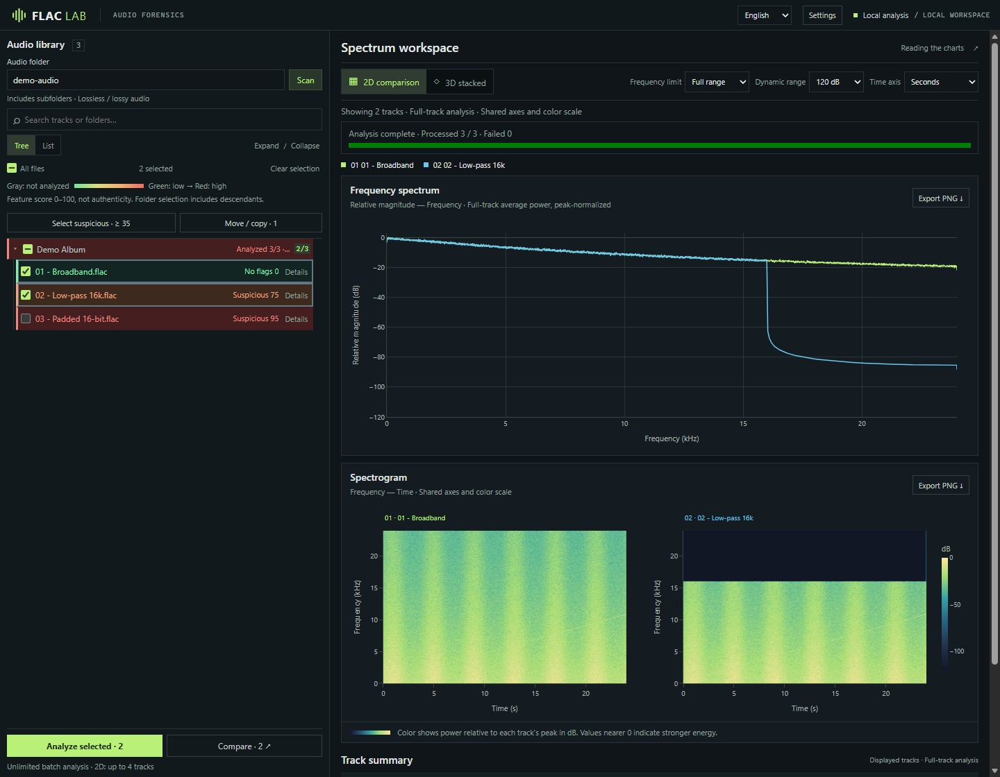
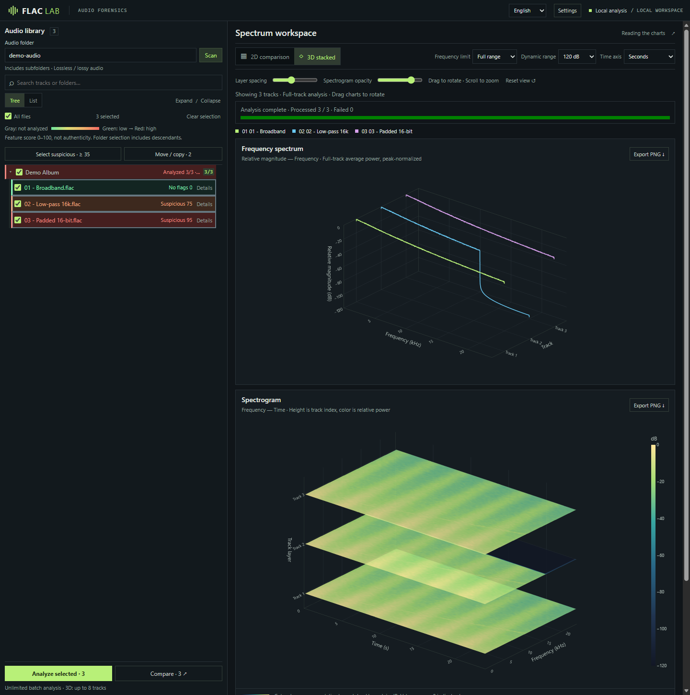

# LosslessLens

**English** | [简体中文](README.zh-CN.md) | [繁體中文](README.zh-TW.md) | [日本語](README.ja.md)

A local audio screening and spectrum comparison tool. Scan a music library for signs of lossy transcoding, upsampling and padded bit depth, then compare tracks in 2D or 3D.

**[Download for Windows](#download-for-windows-no-python-needed)** · [From source](#quick-start-from-source) · [Usage guide (Chinese)](docs/usage.md) · [Command line](#other-ways-to-use-it)

> Scores measure suspicious features, not authenticity probabilities. Recording bandwidth and mastering filters can produce similar signs. A clean result does not prove a genuine lossless source.

## Features

- **Batch screening:** scan folders recursively, select tracks or albums, analyze with multiple processes and inspect per-track evidence.
- **Spectrum comparison:** compare up to 4 tracks in 2D or 8 in 3D, align axes and color scales, and export PNG images.
- **Library organization:** select tracks by an adjustable score threshold, then copy or move them while optionally preserving folders. Existing files are never overwritten.
- **Multiple formats:** FLAC, WAV, AIFF, MP3, M4A, AAC, OGG, Opus and more. Some formats require FFmpeg.
- **Local processing:** the server listens only on `127.0.0.1`, charts use bundled resources, audio stays off the cloud, and session caching avoids repeat analysis.

## Screenshots

**Library screening and 2D comparison**



**Stacked 3D comparison**



Screenshots use synthetic audio illustrating broadband, a 16 kHz low-pass filter and 16-bit padding. The interface supports English and Simplified Chinese; switch languages in the header.

## Download for Windows (no Python needed)

1. Download **LosslessLens-windows-x64.zip** from the [latest release](https://github.com/Koha9/lossless-lens/releases/latest).
2. Extract the **whole zip** to any folder (do not run it from inside the zip).
3. Double-click **LosslessLens.exe**. A black window opens and your browser shows the app. Enter your music folder in the page, select tracks and click **Analyze**.
4. Close the black window to quit.

If Windows SmartScreen warns that the app is unsigned, click **More info → Run anyway**. MP3/M4A/OGG and similar formats may need [FFmpeg](docs/usage.md#音频格式与-ffmpeg) on PATH. Developers can build the zip with `.\build_onedir.ps1 -Zip`, or push a `v*` tag to have GitHub Actions publish it.

## Quick start (from source)


Python 3.12 is recommended. Run these commands in a terminal with Conda available:

```sh
git clone https://github.com/Koha9/lossless-lens.git
cd lossless-lens
conda env create -f environment.yml
conda run -n flac-forensics python -m pip install -r requirements-web.txt
conda run --no-capture-output -n flac-forensics python web_app.py --folder "D:\Music"
```

Open [http://127.0.0.1:8765](http://127.0.0.1:8765), select tracks and click **Analyze selected** or **Compare**. The initial scan lists files without analyzing them.

- Replace `D:\Music` with your audio folder, including a UNC path if needed. Without `--folder`, the app uses its startup directory; `--port` changes the port.
- Formats SoundFile cannot decode require **FFmpeg / ffprobe**. See the [format guide (Chinese)](docs/usage.md#音频格式与-ffmpeg).
- Press **Ctrl+C** in the terminal to stop the server. Closing the browser does not stop it.

## Workflow

1. Open **Settings** to set the analysis process count and selection threshold, then save.
2. After analysis, **Select suspicious** replaces the selection with matching tracks, including those hidden by search.
3. Open **Move / copy**, review destination paths and execute. Moving removes the source only after a complete copy succeeds; review the evidence first.

Analysis does not rewrite audio. Charts normalize each track to its own peak and **cannot compare absolute loudness**. Transfer rules, cache behavior and scoring are covered in the [usage guide (Chinese)](docs/usage.md).

## Other ways to use it

```sh
# Recursively analyze FLAC files and export CSV
conda run -n flac-forensics python flac_forensics.py "D:\Music\album" --csv report.csv

# Save an individual report and plots
conda run -n flac-forensics python flac_forensics.py "track.flac" --json report.json --spectrum spectrum.png --spectrogram spectrogram.png
```

- **Windows bundle:** build a Web entry point that runs without Python; see [build instructions (Chinese)](docs/usage.md#windows-打包).
- **Development:** see [test instructions (Chinese)](docs/usage.md#开发与测试).

## Project note

Much of this project was developed with AI assistance and has not undergone a comprehensive review. Use it for personal screening and comparison, rather than as the sole evidence of a recording's authenticity.
