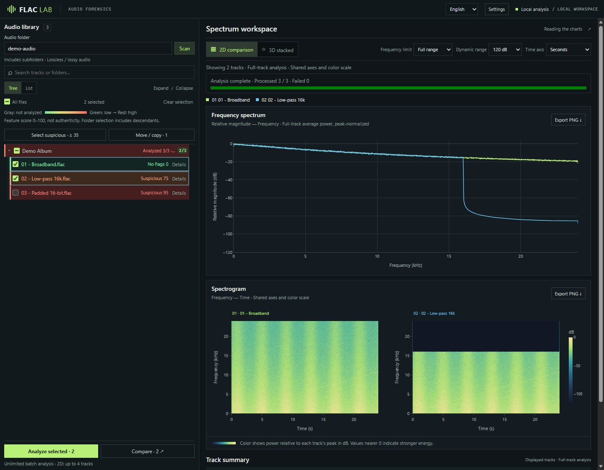
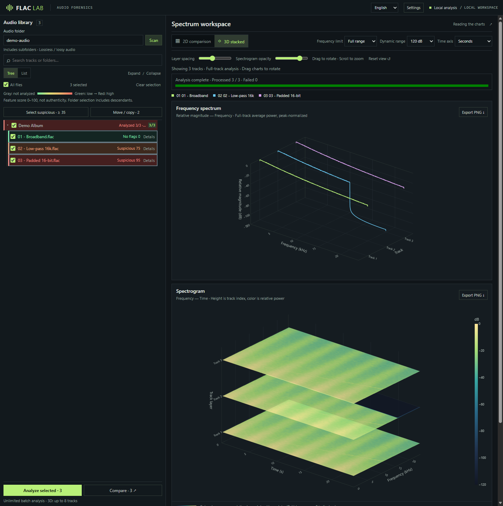

# LosslessLens

[English](README.md) | **简体中文** | [繁體中文](README.zh-TW.md) | [日本語](README.ja.md)

本地音频筛查与频谱对比工具。批量查看歌曲中可能存在的有损转码、升采样和位深补零迹象，再用 2D / 3D 图表对比细节。

**[快速开始](#快速开始)** · [使用指南](docs/usage.md) · [命令行用法](docs/usage.md#命令行)

> 评分表示可疑特征强度，不是真伪概率。录音带宽、母带滤波等也会触发提示；未检出异常不等于确认真实无损。

## 功能

- **批量筛查**：递归扫描曲库，按文件或文件夹选择，多进程分析，逐首显示评分与判断依据。
- **频谱对比**：2D 最多对比 4 首，3D 最多 8 首；统一频率、时间与色阶，支持导出 PNG。
- **曲目整理**：按可调评分阈值一键勾选，复制或移动到指定目录，默认保留目录结构，不覆盖同名文件。
- **多格式支持**：FLAC、WAV、AIFF、MP3、M4A、AAC、OGG、Opus 等，部分格式需要 FFmpeg。
- **本机处理**：服务仅监听 `127.0.0.1`，图表资源随依赖提供，音频不上传云端；会话缓存减少重复分析。

## 界面预览

**曲库筛查与 2D 对比**



**3D 斜向堆叠**



截图使用合成演示音频，展示宽频信号、16 kHz 低通和 16-bit 补零特征。界面支持 English 与简体中文，可在页面右上角切换。

## Windows 下载使用（无需 Python）

1. 在[最新 Release](https://github.com/Koha9/lossless-lens/releases/latest)下载 **LosslessLens-windows-x64.zip**。
2. 把 zip **完整解压**到任意文件夹（不要在压缩包内直接运行）。
3. 双击 **LosslessLens.exe**，会出现黑色窗口并自动打开浏览器；在页面输入音乐文件夹，选择曲目后点击“分析”。
4. 关闭黑色窗口即可退出。

若 SmartScreen 提示未签名，点击“更多信息 → 仍要运行”。MP3/M4A/OGG 等格式可能需要把 [FFmpeg](docs/usage.md#音频格式与-ffmpeg) 加入 PATH。开发者可用 `.\build_onedir.ps1 -Zip` 自行打包，或推送 `v*` 标签由 GitHub Actions 自动发布。

## 从源码运行


推荐 Python 3.12。以下命令在已安装 Conda 的终端执行：

```sh
git clone https://github.com/Koha9/lossless-lens.git
cd lossless-lens
conda env create -f environment.yml
conda run -n flac-forensics python -m pip install -r requirements-web.txt
conda run --no-capture-output -n flac-forensics python web_app.py --folder "D:\Music"
```

打开 [http://127.0.0.1:8765](http://127.0.0.1:8765)，勾选曲目后点击「分析所选」或「生成对比」。首次扫描只列出文件，不自动分析。

- 将 `D:\Music` 替换为音频目录，也可使用 UNC 路径。省略 `--folder` 时使用启动目录，`--port` 可更改端口。
- SoundFile 无法解码的格式需要 **FFmpeg / ffprobe**，配置方法见[使用指南](docs/usage.md#音频格式与-ffmpeg)。
- 在终端按 **Ctrl+C** 停止服务。关闭浏览器不会退出服务。

## 使用提示

1. 在「设置」中调整分析进程数与可疑勾选阈值；点击保存后生效。
2. 分析后点击「勾选可疑」，会替换当前勾选，包含搜索隐藏的匹配曲目。
3. 点击「移动／复制」，核对目标路径预览后执行。移动会在完整复制成功后删除源文件；请先查看评分依据。

分析本身不改写音频。图表按每首曲目的峰值归一化，适合比较频率分布，**不能比较绝对响度**。文件整理规则、缓存位置和评分说明见[使用指南](docs/usage.md)。

## 其他用法

```sh
# 批量分析 FLAC，导出 CSV
conda run -n flac-forensics python flac_forensics.py "D:\Music\album" --csv report.csv

# 单文件报告与图表
conda run -n flac-forensics python flac_forensics.py "track.flac" --json report.json --spectrum spectrum.png --spectrogram spectrogram.png
```

- **Windows 目录包**：支持构建无需 Python 的 Web 入口，见[打包说明](docs/usage.md#windows-打包)。
- **开发与测试**：见[开发说明](docs/usage.md#开发与测试)。

## 项目说明

本项目包含大量 AI 辅助生成的代码，尚未经过全面审查。适合个人筛查与对比，不应将结果作为音源真伪的唯一依据。
