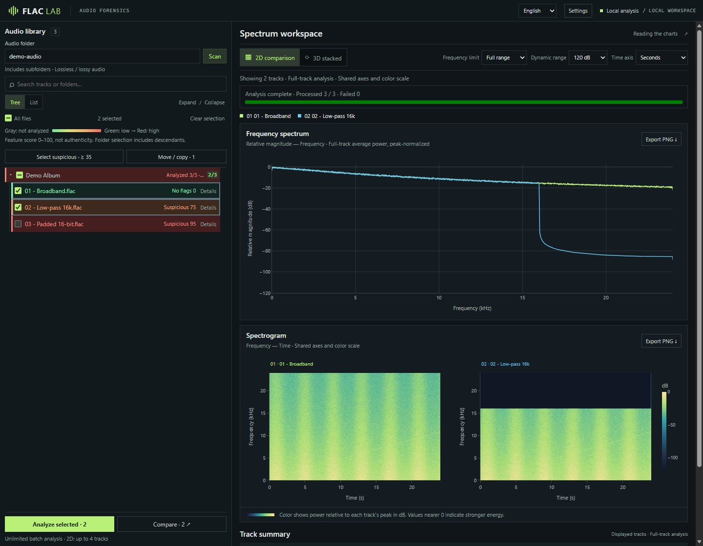
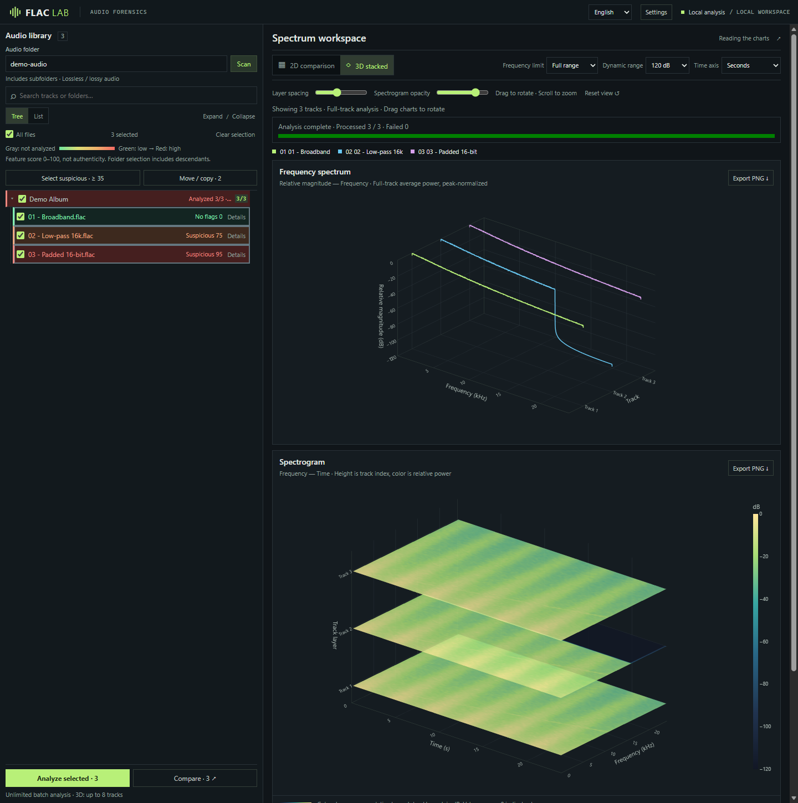

# LosslessLens

[English](README.md) | [简体中文](README.zh-CN.md) | **繁體中文** | [日本語](README.ja.md)

本機音訊篩查與頻譜比較工具。批次檢視歌曲中可能存在的有損轉碼、升頻和位元深度補零跡象，再透過 2D / 3D 圖表比較細節。

**[快速開始](#快速開始)** · [使用指南（簡體中文）](docs/usage.md) · [命令列](#其他用法)

> 分數表示可疑特徵的強度，不是真偽機率。錄音頻寬、母帶濾波等也會觸發提示；未檢出異常不代表已確認是真正的無損來源。

## 功能

- **批次篩查**：遞迴掃描曲庫，依檔案或資料夾選取，以多行程分析，逐首顯示分數與判斷依據。
- **頻譜比較**：2D 最多比較 4 首，3D 最多 8 首；統一頻率、時間與色階，支援匯出 PNG。
- **曲目整理**：依可調整的分數門檻一鍵勾選，複製或移動至指定目錄，預設保留目錄結構，不覆寫同名檔案。
- **多格式支援**：FLAC、WAV、AIFF、MP3、M4A、AAC、OGG、Opus 等，部分格式需要 FFmpeg。
- **本機處理**：服務僅監聽 `127.0.0.1`，圖表資源隨相依套件提供，音訊不上傳雲端；工作階段快取可減少重複分析。

## 介面預覽

**曲庫篩查與 2D 比較**



**3D 斜向堆疊**



截圖使用合成示範音訊，展示寬頻訊號、16 kHz 低通與 16-bit 補零特徵。介面支援 English 與簡體中文，可在頁面右上角切換。

## Windows 下載使用（無需 Python）

1. 在[最新 Release](https://github.com/Koha9/lossless-lens/releases/latest)下載 **LosslessLens-windows-x64.zip**。
2. 將 zip **完整解壓縮**到任意資料夾。
3. 按兩下 **LosslessLens.exe**，會出現黑色視窗並自動開啟瀏覽器；在頁面輸入音樂資料夾後選擇曲目進行分析。
4. 關閉黑色視窗即可結束。

SmartScreen 若提示未簽署，請點「其他資訊 → 仍要執行」。

## 從原始碼執行


建議使用 Python 3.12。請在已安裝 Conda 的終端機執行：

```sh
git clone https://github.com/Koha9/lossless-lens.git
cd lossless-lens
conda env create -f environment.yml
conda run -n flac-forensics python -m pip install -r requirements-web.txt
conda run --no-capture-output -n flac-forensics python web_app.py --folder "D:\Music"
```

開啟 [http://127.0.0.1:8765](http://127.0.0.1:8765)，勾選曲目後點擊 **Analyze selected** 或 **Compare**。首次掃描只列出檔案，不會自動分析。

- 將 `D:\Music` 替換為音訊目錄，也可使用 UNC 路徑。省略 `--folder` 時使用啟動目錄，`--port` 可變更連接埠。
- SoundFile 無法解碼的格式需要 **FFmpeg / ffprobe**，設定方式請參閱[使用指南（簡體中文）](docs/usage.md#音频格式与-ffmpeg)。
- 在終端機按 **Ctrl+C** 停止服務。關閉瀏覽器不會結束服務。

## 使用提示

1. 在 **Settings** 中調整分析行程數與可疑曲目勾選門檻，儲存後生效。
2. 分析後點擊 **Select suspicious**，以符合條件的曲目取代目前勾選，包含搜尋隱藏的曲目。
3. 開啟 **Move / copy**，核對目標路徑預覽後執行。移動會在完整複製成功後刪除來源檔案，請先檢視評分依據。

分析本身不會改寫音訊。圖表依每首曲目的峰值正規化，適合比較頻率分布，**無法比較絕對響度**。檔案整理規則、快取位置及評分說明請參閱[使用指南（簡體中文）](docs/usage.md)。

## 其他用法

```sh
# 批次分析 FLAC，匯出 CSV
conda run -n flac-forensics python flac_forensics.py "D:\Music\album" --csv report.csv

# 單一檔案的報告與圖表
conda run -n flac-forensics python flac_forensics.py "track.flac" --json report.json --spectrum spectrum.png --spectrogram spectrogram.png
```

- **Windows 目錄套件**：可建置不需 Python 的 Web 入口，請參閱[打包說明（簡體中文）](docs/usage.md#windows-打包)。
- **開發與測試**：請參閱[開發說明（簡體中文）](docs/usage.md#开发与测试)。

## 專案說明

本專案包含大量 AI 輔助產生的程式碼，尚未經過全面審查。適合個人篩查與比較，不應將結果作為音源真偽的唯一依據。
